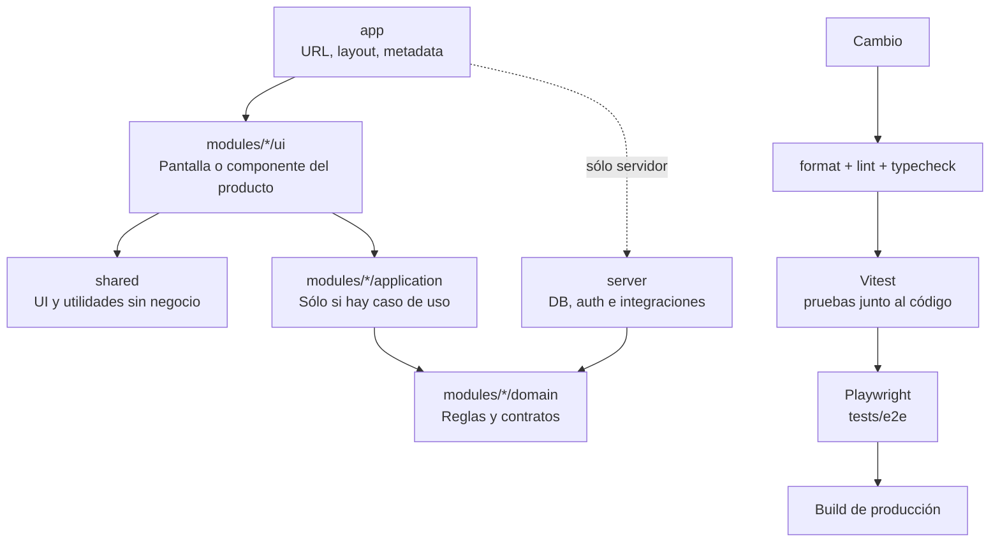

# ABC · Next.js Modular Starter

> Una plantilla de Next.js pensada para iniciar productos mantenibles: pequeña al principio, modular cuando el producto crece y preparada para colaborar con personas y agentes de IA.

[](https://nextjs.org/)
[](https://react.dev/)
[](https://www.typescriptlang.org/)
[](#)

## ¿Qué resuelve?

ABC evita dos extremos comunes: una app con todo mezclado en `components/`, `services/` y `utils/`, o una arquitectura demasiado pesada desde el primer commit. Organiza el producto por capacidades de negocio y sólo incorpora nuevas capas cuando una funcionalidad las necesita.

Es una buena base para:

- Productos SaaS, paneles internos y aplicaciones web que crecerán por módulos.
- Equipos que combinan componentes propios y librerías de UI.
- Proyectos que podrán vivir en una app, un monorepo o varios repositorios coordinados.
- Equipos que trabajan con agentes de IA y necesitan reglas de estructura verificables.

## Stack tecnológico

| Tecnología                                                             | Uso en la plantilla                                             |
| ---------------------------------------------------------------------- | --------------------------------------------------------------- |
| [Next.js 16](https://nextjs.org/)                                      | Framework full-stack, App Router y optimización de producción.  |
| [React 19](https://react.dev/)                                         | Interfaz de usuario y Server/Client Components.                 |
| [TypeScript](https://www.typescriptlang.org/)                          | Tipado estricto y contratos claros.                             |
| [Turbopack](https://nextjs.org/docs/app/api-reference/turbopack) + SWC | Bundling y transpilación rápidos, incluidos por Next.js.        |
| ESLint                                                                 | Calidad de código y reglas de Next.js.                          |
| Prettier                                                               | Formato consistente para código, configuración y documentación. |
| GitHub Actions                                                         | Verificación automática en cada pull request y push a `main`.   |

## Runtime de Node.js

La plantilla usa **Node.js 24.20.0 LTS**. Es la línea estable fijada para desarrollo y CI; evita adoptar la rama "Current" antes de que madure. `.nvmrc`, `package.json` y GitHub Actions mantienen la misma versión.

## Arquitectura



```text
src/
├─ app/                    # Rutas, layouts, metadata y handlers de Next.js
├─ modules/                # Capacidades: projects/, auth/, billing/, etc.
│  └─ <modulo>/
│     ├─ ui/               # UI exclusiva del módulo
│     ├─ application/      # Casos de uso, sólo si existen
│     ├─ domain/           # Reglas y contratos, sólo si existen
│     ├─ data/             # DTOs/mappers/queries, sólo si existen
│     ├─ hooks/            # Hooks propios, sólo si existen
│     └─ schemas/          # Validación, sólo si existe
├─ shared/                 # UI y utilidades sin vocabulario de negocio
└─ server/                 # DB, auth e integraciones privadas cuando se requieran
```

`app/` conoce las URLs; un módulo conoce una capacidad del producto; `shared/` no conoce el negocio; `server/` conserva secretos y adaptadores privados. Las carpetas son permitidas, no obligatorias: no se crean directorios vacíos ni capas “por si acaso”.

La guía ampliada está en [docs/architecture.md](docs/architecture.md).

## Piezas opcionales y qué se puede eliminar

La plantilla no obliga a conservar capas sin uso. Elimina una pieza sólo junto con su configuración, scripts, CI y documentación relacionados.

| Pieza                                                         | Úsala cuando                                                               | Se puede eliminar si                                                                                                              |
| ------------------------------------------------------------- | -------------------------------------------------------------------------- | --------------------------------------------------------------------------------------------------------------------------------- |
| `modules/*/application`, `domain`, `data`, `hooks`, `schemas` | La capacidad tiene esa responsabilidad real                                | Aún no existe esa responsabilidad; no crees directorios vacíos.                                                                   |
| `src/server/`                                                 | Hay DB, autenticación, secretos o integración privada                      | La app no tiene infraestructura de servidor propia.                                                                               |
| `tests/e2e/` + Playwright                                     | Hay flujos críticos de navegador, rutas, cookies o Server Components async | Es un prototipo sin flujo de navegador que proteger. Quita también `playwright.config.ts`, `test:e2e`, dependencia y pasos de CI. |
| Vitest y pruebas junto a fuente                               | Quieres feedback rápido de lógica o componentes                            | Sólo en un experimento desechable. Quita `vitest.config.mts`, `vitest.setup.ts`, tests, scripts, dependencias y CI relacionados.  |
| GitHub Actions                                                | Quieres validar cada push o pull request en remoto                         | El workflow está comentado por defecto; descomenta `.github/workflows/ci.yml` para activarlo.                                     |
| Husky                                                         | Quieres bloquear commits locales que no pasen calidad                      | Instala Husky y activa `.husky/pre-commit.example`; no se instala ni ejecuta por defecto.                                         |
| `.codex/skills/` y `AGENTS.md`                                | Colaboran agentes o quieres hacer cumplir la arquitectura                  | Trabaja un equipo que no usará agentes ni estas reglas; perderás sus límites documentados.                                        |

No elimines `src/app/`, `src/shared/`, TypeScript, ESLint, Prettier ni la configuración de Node: son el núcleo mínimo de la plantilla.

## Inicio rápido

```bash
git clone https://github.com/RogerG03/abc-next-js.git
cd abc-next-js
nvm use
npm install
npm run dev
```

Si no usas `nvm`, instala Node.js 24 LTS y comprueba `node --version` antes de ejecutar `npm install`.

Abre [http://localhost:3000](http://localhost:3000).

## Scripts

| Comando                | Descripción                                  |
| ---------------------- | -------------------------------------------- |
| `npm run dev`          | Inicia el entorno local con Turbopack.       |
| `npm run lint`         | Ejecuta ESLint.                              |
| `npm run typecheck`    | Ejecuta TypeScript sin emitir archivos.      |
| `npm run test`         | Ejecuta pruebas unitarias y de componentes.  |
| `npm run test:watch`   | Ejecuta las pruebas unitarias en modo watch. |
| `npm run test:e2e`     | Ejecuta el flujo E2E en Chromium.            |
| `npm run format`       | Aplica formato con Prettier.                 |
| `npm run format:check` | Verifica el formato sin modificar archivos.  |
| `npm run build`        | Genera el build optimizado de producción.    |
| `npm run start`        | Sirve el build de producción.                |

## Convenciones para personas y agentes

La plantilla incluye la skill local [`next-modular-architecture`](.codex/skills/next-modular-architecture/SKILL.md) y un [`AGENTS.md`](AGENTS.md). Antes de tocar la estructura, cualquier agente debe leerlas.

Estas reglas impiden crear carpetas genéricas como `src/components`, `src/services`, `src/utils` o `src/features`. También definen:

- Nombres para archivos, componentes, hooks, tipos, DTOs y esquemas.
- Límites de importación entre `app`, `modules`, `shared` y `server`.
- Ubicación de imágenes, iconos y fuentes.
- Criterios para crecer a monorepo o coordinar varias apps desde un repositorio orquestador.

## Cuando haya varios repositorios

Cada aplicación conserva esta arquitectura y puede instalarse, probarse y desplegarse por sí sola. El repositorio orquestador conserva ADRs, contratos API versionados, composición local y CI reutilizable; no absorbe el código de las aplicaciones.

El código compartido se publica como paquetes versionados —por ejemplo `@organizacion/ui` y `@organizacion/contracts`— o se comparte mediante contratos API. No se usan imports relativos entre repositorios, copias manuales ni submódulos Git como dependencias de producción.

## Calidad continua

GitHub Actions viene como receta **comentada** en `.github/workflows/ci.yml`; no se ejecuta hasta que la descomentes. Al activarla, ejecuta en cada pull request:

```text
format:check → lint → typecheck → test → test:e2e → build
```

Las pruebas unitarias viven junto al archivo que cubren. Los recorridos E2E viven en `tests/e2e/`; Playwright usa Chromium y arranca Next automáticamente.

Así, una modificación no llega a `main` sin cumplir las reglas básicas de estilo, tipado, pruebas y compilación.

Husky también es opcional. Para activarlo, instala `husky`, ejecuta `npx husky init`, sustituye el hook generado por `.husky/pre-commit.example` y descomenta los checks que quieras aplicar antes de cada commit.
