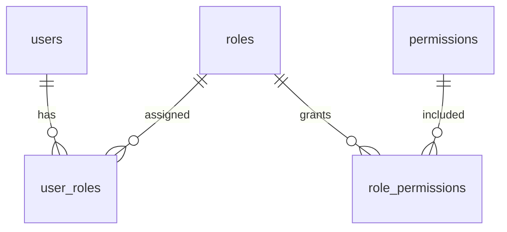

# Plan futuro: Permix y permisos en base de datos

**Estado: plan futuro; no implementado en esta plantilla.** Esta guía propone un punto de partida para un producto derivado. No aprueba un esquema definitivo ni activa autorización. No crear carpetas vacías, paquetes, tablas o políticas hasta que exista un caso real.

## Qué resuelve cada pieza

- **Autenticación** identifica a la persona y crea/valida su sesión. El proveedor de login sigue pendiente.
- **Autorización** decide si esa persona puede realizar una acción sobre un recurso.
- **Persistencia** guarda identidades y asignaciones. El ORM sigue pendiente; la arquitectura no obliga a usar Prisma.

Permix evalúa reglas tipadas; no incorpora base de datos, autenticación ni un panel mágico de administración RBAC. Su integración oficial para Next.js ofrece `createPermix` mediante React `cache`, que [sólo reutiliza esa caché durante el render de componentes](https://react.dev/reference/react/cache). No des por hecho que una configuración o comprobación comparte instancia en cada Route Handler o Server Action. En cada entrada de servidor, crea/carga explícitamente el contexto con la factory de core y pasa esa misma instancia al caso de uso; usa un wrapper oficial sólo después de comprobarlo en el runtime y versión elegidos. Nunca guardes instancia ni permisos de usuario en un singleton de módulo. Revisa la API vigente al implementar.

## Modelo de datos propuesto

Es un modelo conceptual que debe ajustarse al proveedor de identidad y al producto:

| Tabla              | Campos conceptuales                                                              |
| ------------------ | -------------------------------------------------------------------------------- |
| `users`            | `id` UUID, `external_subject` opcional y único, `is_active`, fechas de auditoría |
| `roles`            | `id` UUID, `code` único y estable, `name`, `is_active`                           |
| `permissions`      | `id` UUID, `code` único y estable (por ejemplo `record.read`), `description`     |
| `user_roles`       | `user_id`, `role_id`                                                             |
| `role_permissions` | `role_id`, `permission_id`                                                       |

Usa claves primarias y foráneas requeridas, restricciones `UNIQUE` en códigos e identificadores externos, y claves únicas compuestas en `user_roles (user_id, role_id)` y `role_permissions (role_id, permission_id)`. Estas dos tablas representan asignaciones actuales: al revocar, elimina la relación. Desactiva identidades y conserva su autoría; registra por separado eventos persistentes de asignación/revocación con actor, fecha, objetivo y antes/después, en la misma transacción del cambio. Define la retención según el producto. Si hay varios emisores de identidad, la unicidad externa corresponde al par emisor/subject. UUID identifica una fila, no concede acceso. Los roles de aplicación son distintos de los roles internos del motor PostgreSQL.



Define el catálogo de permisos en el contrato del código, con códigos estables; guarda en la base de datos las asignaciones de roles. Versiona y revisa los cambios de asignación inicial (seed) junto con cada cambio de catálogo. Un permiso nuevo no debe concederse automáticamente. No crees una tabla por rol, booleanos por pantalla ni ejecutes expresiones JavaScript almacenadas en la base de datos.

Los roles y permisos generales no bastan para limitar datos: autorizar `record.read` no significa que cualquier usuario pueda leer cualquier registro. Comprueba además la relación con el recurso y aplica el alcance dentro de la consulta; no confíes en que conocer un ID o tener un rol profesional baste. Devuelve sólo los datos mínimos autorizados. El aislamiento de datos entre instalaciones depende del producto; no anticipes un diseño SaaS con tenants o RLS sin necesidad real.

## Encaje con esta arquitectura

```text
modules/access/domain       permiso y regla pura
modules/access/application caso de uso, cuando exista
server/auth                sesión y fábrica Permix por solicitud
server/db/repositories     persistencia privada
modules/access/ui          experiencia de interfaz
```

Son destinos futuros, no directorios para crear ahora. Mantén Redux como estado de interfaz. Permix en `permix/react` puede ocultar o mostrar acciones para orientar la UI, pero no protege datos. Hidrata sólo una proyección mínima de capacidades autorizada por el servidor; la hidratación de Permix no determina por sí misma que esté listo y la configuración cliente debe establecer sus reglas. No incluyas funciones ni datos clínicos o secretos en el payload de permisos hidratado; la pantalla puede recibir los datos que su usuario está autorizado a ver. Reinicia el proveedor cliente al cambiar usuario, iniciar o cerrar sesión.

Deniega por defecto, también ante códigos desconocidos. Considera únicamente cuentas y roles activos. Si una persona tiene varios roles, combina sus concesiones con OR; el permiso concedido aún debe cumplir el alcance del recurso (AND). Por ahora no agregues herencia ni denegaciones que sobrescriban concesiones. Obtén el usuario real y el recurso en el servidor. Cada Server Action y Route Handler verifica autorización directamente; un layout, `proxy`, Redux o una comprobación en cliente no cubren accesos directos. Las consultas, contadores y exportaciones también aplican el alcance autorizado. Sigue la [guía de autenticación de Next.js](https://nextjs.org/docs/app/guides/authentication) y ensaya el ciclo de vida del contexto por tipo de entrada.

Al administrar asignaciones, verifica permisos en el servidor, registra quién hizo el cambio y evita autoelevarse o quitar el último administrador. La revocación no debe depender de un JWT antiguo ni de caché global. Coordina verificación y escritura en una transacción cuando el riesgo lo requiera; si falla la base de datos, deniega el acceso.

Consulta la [integración de Permix con Next.js](https://permix.letstri.dev/docs/integrations/next), [presets tipados](https://permix.letstri.dev/docs/guide/template), [reglas con datos y acciones requeridas](https://permix.letstri.dev/docs/guide/setup) y [hidratación](https://permix.letstri.dev/docs/guide/hydration) al implementar; sus APIs pueden cambiar.

## Adopción por etapas

1. Acordar proveedor de login, matriz de permisos y alcance por recurso; definir quién administra roles.
2. Diseñar y ensayar migraciones aditivas en una copia con respaldo. No asignar permisos implícitos a cuentas existentes.
3. Implementar comprobaciones de servidor y probar casos permitidos y denegados antes de conectar la UI.
4. Añadir UI administrativa tras asegurar cada operación en servidor, incluida su auditoría y revocación.

La verificación futura debe cubrir usuarios A/B y solicitudes concurrentes, acceso directo a API y Server Actions, IDs ajenos, identidades desactivadas, revocación, errores de base de datos (deniegan), rollback e integridad referencial. Implementa primero en una rama/local con datos de prueba y activa el sistema sólo cuando esos casos pasen.

Decisiones aún pendientes: proveedor de login, matriz concreta de roles y permisos, y reglas de alcance por recurso.
